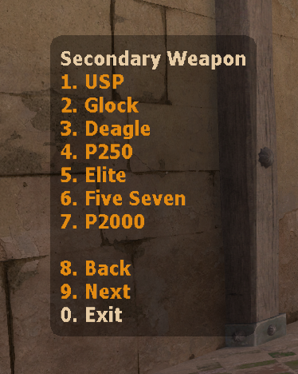
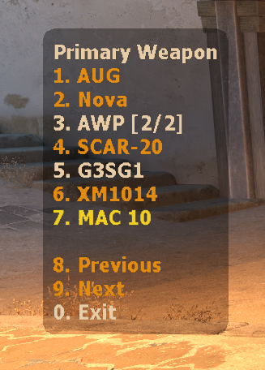
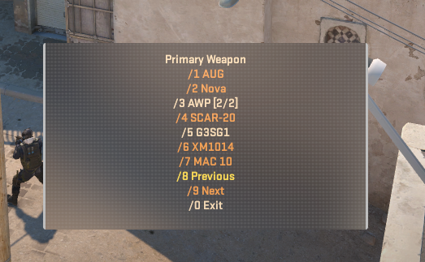

# SharpModMenu

A native CSSUniversalMenuAPI implementation, mirroring the behavior of SourceMod radio menus for CounterStrikeSharp.

https://www.youtube.com/watch?v=Be7qop6pVpI

## Build / Package

From the repo root:

```powershell
powershell -ExecutionPolicy Bypass -File .\compile.ps1
```

Or on Windows:

```bat
.\compile.cmd
```

Output:

- `compiled/counterstrikesharp/plugins/SharpModMenu`
- `compiled/counterstrikesharp/shared/SharpModMenu`
- `compiled/counterstrikesharp/shared/CSSUniversalMenuAPI`

When number keys are bound with the following snippet, automatically detected and the menu will look like it used to in CSS and CS:GO:

```
bind 1 "slot1;css_1" // menuselect 1 is also supported
bind 2 "slot2;css_2"
...
bind 9 "slot9;css_9"
bind 0 "slot0;css_0"
```



When these binds are not present, the player is prevented from moving, and the following keys are used to control the menu:

| Key         | Action              |
|-------------|---------------------|
| Forward (W) | Move selection up   |
| Back (S)    | Move selection down |
| Left (A)    | Previous/back       |
| Right (D)   | Next                |
| Use (E)     | Select item         |
| Reload (R)  | Exit                |



In the event that there is no spectator on which to create the predicted view model, the system will further fall back to
a CenterHtmlMenu for that free roaming player.

> [!NOTE]  
> Since the 2025 July update, a method to parent an entity to a player's view is unknown or impossible.
> Unless a new method is found, SharpModMenu will always use the "fallback" HTML menu.



Many thanks to [@T3Marius's CS2ScreenMenuAPI](https://github.com/T3Marius/CS2ScreenMenuAPI) for acting as reference when it comes to using the point_worldtext entity.

## Configuration

SharpModMenu can be customized with:

- `sharpmodmenu_config.jsonc`
- `sharpmodmenu_translations.jsonc`

These files are read from the plugin folder (`addons/counterstrikesharp/plugins/SharpModMenu`).
Compatibility names are also supported:

- `menu_config.jsonc`
- `menu_translations.jsonc`

Lookup order now prefers `addons/counterstrikesharp/shared/SharpModMenu` first (for both canonical and compatibility names), then falls back to `plugins/SharpModMenu`.
If multiple matching files exist, the most recently modified file is selected.

For larger HTML font classes (anything different from `fontSize-s`), the menu uses a compact footer line.
You can customize that line with:

- `HtmlCompactFooterMessage` (in config), or
- `nav.compact_message` (in translations).
- `HtmlCompactFooterFontClass` (in config) to change size only for that footer line.

WASD navigation can auto-change pages at list boundaries:

- `WasdAutoPage: true` (default): moving past the first/last item switches page.
- `WasdAutoPage: false`: keep classic behavior and use navigation entries/buttons.

Input hook compatibility:

- `ForceFallbackInput: false` (default): read input from the raw `ProcessUserCmds` hook.
- `ForceFallbackInput: true`: skip that hook and use the fallback input reader. Enable this when another plugin, such as CS2AC, hooks `ProcessUserCmds` incompatibly.

Selectable entries are rendered with selector icons instead of numeric prefixes:

- `SelectorIcon` (default `➜`)
- `SelectorIconColor` (HTML color for that icon)

Movement freeze while menu is open:

- `FreezePlayerMovement: true` (default): sets player `MoveType` to `NONE` while menu is open, then restores previous move type on close.

Reload live with:

```
css_sharpmodmenu_reload
```

Player position tuning:

```
css_sharpmodmenu_pos_x <value>
css_sharpmodmenu_pos_y <value>
```

<!--

TODO:
- Sounds

-->
